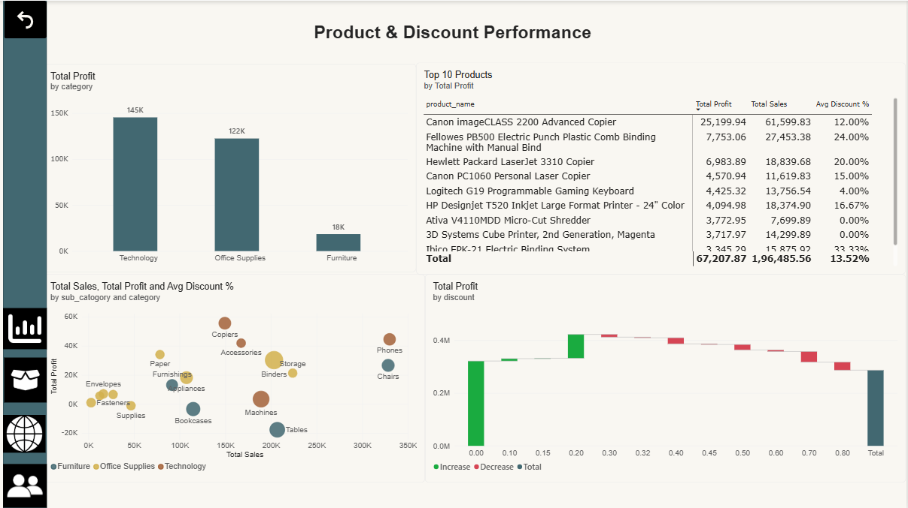
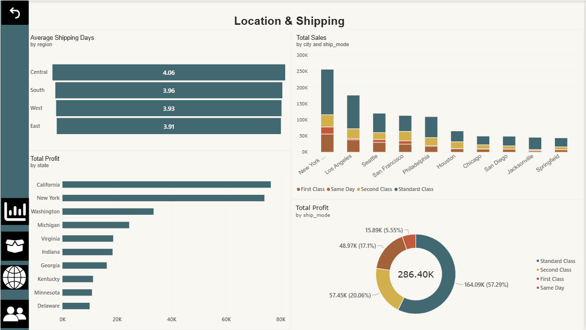

# Superstore Executive Sales & Profitability Dashboard (Excel | PostgreSQL | Power BI)

An end-to-end interactive 4-page Power BI business intelligence solution analyzing **$2.30M in revenue**, **$286.40K in profit (12.47% margin)**, and **5,009 orders** across **793 customers** (`2014–2017`).

---

## End-to-End Data Pipeline & Architecture
1. **Data Extraction & Cleaning (Excel Power Query):**
   - Sourced raw Superstore retail order records from Kaggle (`9,994` rows).
   - Cleaned missing values, standardized text formatting, removed duplicates, and prepared structured tables using **Excel Power Query**.
2. **Database Storage & Schema Validation (PostgreSQL / pgAdmin):**
   - Created the relational table schema in **PostgreSQL (pgAdmin)** and imported the cleaned dataset.
   - Standardized `DMY`/`MDY` date format discrepancies (`order_date`, `ship_date`), enforced strict SQL data types (`DATE`, `NUMERIC`, `VARCHAR`), and validated row counts prior to BI ingestion.
3. **Data Modeling, DAX & Interactive UX (Power BI):**
   - Connected Power BI directly to PostgreSQL and modeled a normalized **Star Schema** (`fact_orders`, `dim_Products`, `dim_Customers`, `dim_Location`, and a dynamic DAX `Calendar` table).
   - Built custom DAX measures for YoY Sales (`SAMEPERIODLASTYEAR`), Profit Margin (`12.47%`), Average Order Value (`$458.61`), Average Shipping Days (`3.96 days`), and Repeat vs. One-Time Buyer segmentation (`98.49%` repeat rate).
   - Designed an app-like user experience featuring a custom vertical icon navigation sidebar, bookmark-driven pop-out slicer panel, global filter reset action, and multi-level drill-down hierarchies.

---

## Dashboard Pages & Business Questions Answered

### 1. Executive Summary

* **Key KPIs:** What are our Total Sales (`$2.30M`), Total Profit (`$286.40K`), Total Orders (`5,009`), and Profit Margin % (`12.47%`)?
* **Seasonality:** Which months have the highest and lowest sales (peaking in Q4 during November–December)?
* **Segment Performance:** Which customer segment (`Consumer`, `Corporate`, or `Home Office`) brings in the most profit?
* **Regional Split & YoY Growth:** How is profit distributed across regions, and how do 2017 sales compare to 2016 (`+20.36%` YoY)?

---

### 2. Product & Discount Performance

* **Category Profitability:** Which product categories (`Technology`, `Office Supplies`, `Furniture`) generate the highest profit?
* **Top Performers:** What are our Top 10 most profitable products (led by *Canon imageCLASS 2200 Advanced Copier* at `$25.20K`)?
* **Loss-Making Sub-Categories:** Which sub-categories have high sales but lose money (*Tables* and *Bookcases*)?
* **Discount Threshold Analysis:** At what discount percentage do orders start losing money (profits turn consistently negative above `20%` discount)?

---

### 3. Location & Shipping (Operations)

* **Fulfillment Speed:** How many days on average does it take to ship an order across different regions (`3.91–4.06 days`)?
* **Top Revenue Cities:** Which cities drive the highest sales volume (*New York City*, *Los Angeles*, *Seattle*)?
* **State Profitability:** Which states generate the highest profit (*California*, *New York*, *Washington*) versus net losses (*Texas*, *Ohio*, *Pennsylvania*, *Illinois*)?
* **Shipping Mode Profit Share:** Which shipping mode (`Standard Class` at `57.29%`) contributes the most profit?

---

### 4. Customer Insights

* **Shipping Mode Adoption:** Which shipping mode is used most frequently by customers?
* **Top 10 Customers:** Who are our Top 10 customers by Total Sales and Total Profit (highlighting how heavy discounting caused net losses even on #1 revenue customer *Sean Miller*)?
* **Customer Retention:** How many repeat customers (`781` | `98.49%`) do we have versus one-time buyers (`12` | `1.51%`)?
* **Order Value & Growth:** What is our Average Order Value (`$458.61`), and how has our active customer base grown year over year (`595` to `693`)?

---

## Key Strategic Recommendations
1. **Cap Promotional Discounts at 20%:** Orders discounted above `20%` consistently erode profit margins across all regions—even turning top enterprise accounts unprofitable.
2. **Audit Furniture Pricing & Shipping Costs:** Re-evaluate supplier pricing and shipping subsidies for **Tables** and **Bookcases**, particularly in high-loss states like **Texas** and **Illinois**.
3. **Leverage High Customer Retention (`98.49%`):** Introduce tiered loyalty incentives for repeat buyers to increase Average Order Value (`$458.61`) without relying on deep margin-cutting discounts.
